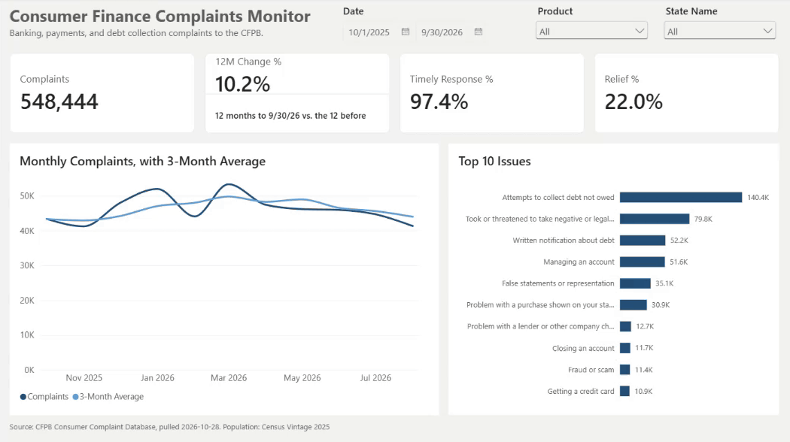
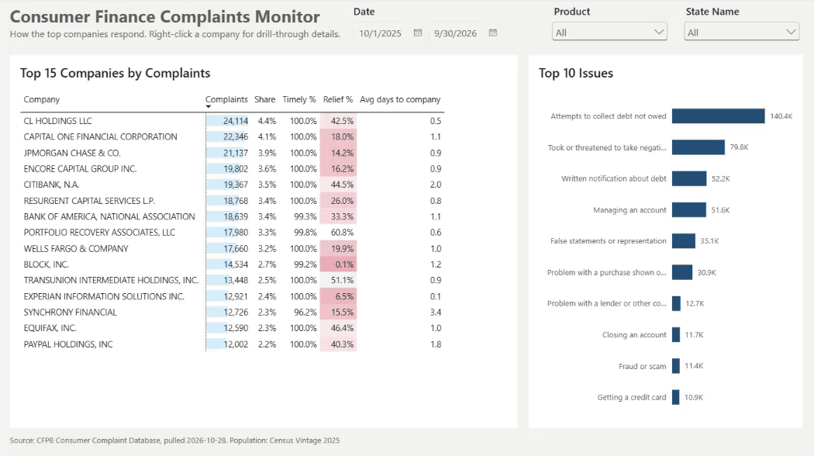
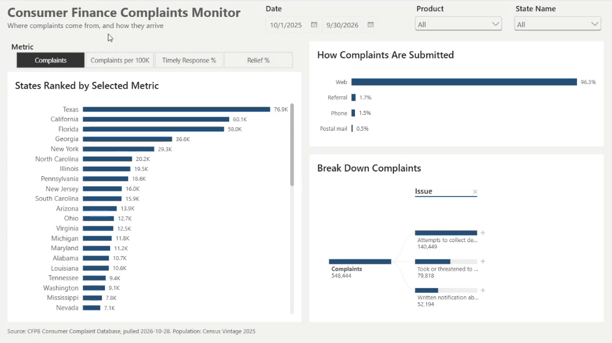
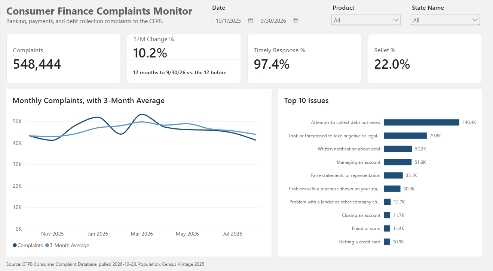
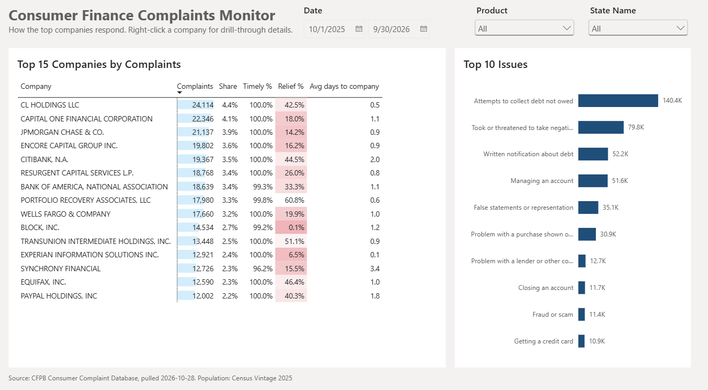
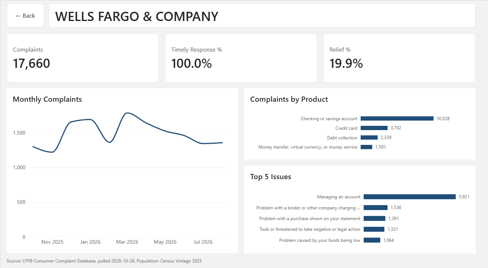
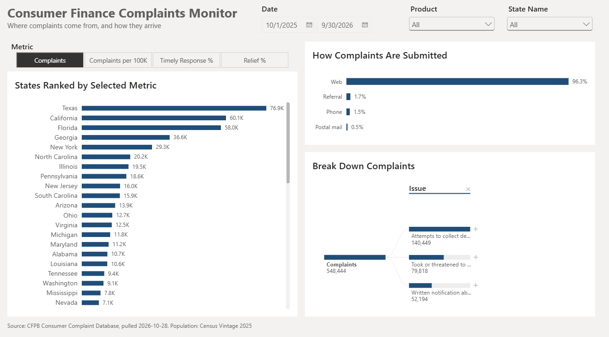
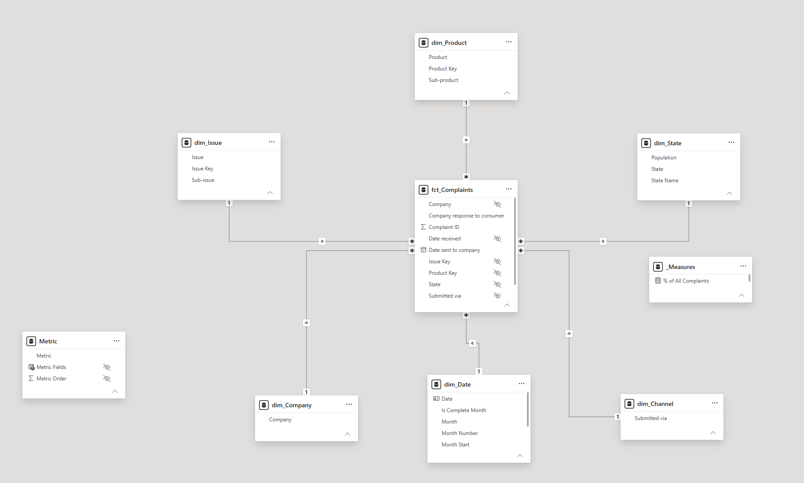

# CFPB Consumer Complaints: Power BI Report

An interactive Power BI report on about 1.4 million consumer complaints filed with the Consumer Financial Protection Bureau (CFPB) from January 2023 to September 2026. It covers four bank and payments products: credit cards, checking and savings accounts, debt collection, and money transfers.

The report answers four questions:

1. How many complaints are coming in, and is the volume rising or falling?
2. Which companies get the most complaints, and how do they respond?
3. What are people complaining about for a given company?
4. Which states complain the most, both in total and per resident?

## Walkthrough

**Overview:** slicers filter every visual on the page, and clicking a bar cross-filters the rest.

**Companies and drill-through:** right-click any company to open its own detail page.

**Geography:** a metric switcher changes the state ranking between total complaints and complaints per 100K residents.

## Report pages

| Page | What it shows |
|---|---|
| Overview | KPI cards (complaints, 12-month change, timely response %, relief %), monthly trend with a 3-month rolling average, top 10 issues |
| Companies | Top 15 companies by complaints, with share of all complaints, timely response %, and relief % |
| Company Detail | Drill-through page for one company: its trend, product mix, and top 5 issues |
| Geography and Channel | States ranked by a selectable metric, complaints by submission channel, and a decomposition tree from issue to company |
| Tooltip Trend | A hidden tooltip page that shows a mini trend line when you hover over a visual |

### Overview

### Companies

### Company Detail (drill-through)

### Geography and Channel

Screenshots show the default view: the latest 12 months (Oct 2025 to Sep 2026).

## Key findings

### 1. One week in January 2025 produced more complaints than any full month

January 2025 had about 101,000 complaints, roughly three times the months on either side (about 30,000 in December 2024 and 35,000 in February 2025). Most of them arrived between January 14 and 21, and four companies account for most of the jump:

| Company | Product | Jan 2025 complaints | Avg month, Jul–Dec 2024 |
|---|---|---|---|
| Block, Inc. (Cash App) | Money transfer | about 30,500 | about 180 |
| Early Warning Services (Zelle) | Money transfer | about 16,500 | about 50 |
| Navy Federal Credit Union | Checking or savings | about 7,400 | about 310 |
| Capital One | Checking or savings | about 4,800 | about 190 |

The timing lines up with public news, not with a single service failure. The CFPB issued an enforcement order against Block on January 16, 2025 ([CFPB](https://www.consumerfinance.gov/enforcement/actions/block-inc/)). Around the same time, TikTok influencers falsely told viewers that filing a CFPB complaint about Zelle or Cash App would get them reimbursed ([Consumer Reports](https://www.consumerreports.org/money/scams-fraud/cfpb-not-giving-money-to-people-scammed-on-zelle-cash-app-a9372236265/)). Capital One had a multi-day outage that week that left customers unable to access deposits ([CNN](https://lite.cnn.com/2025/01/17/business/capital-one-outage-direct-deposits/index.html)). Navy Federal's complaints were mostly about overdrafts ("Problem caused by your funds being low"), two months after a CFPB overdraft order against it ([Consumer Federation of America](https://consumerfed.org/from-refunds-to-reversal-navy-federal-overdraft-complaints-reveal-impact-of-cfpb-rollback-on-military-families/)).

*How I found it:* the monthly trend on Overview showed the spike. Filtering by product showed it came from money transfer and checking/savings. Drilling through to the top companies narrowed it to four, and news coverage from that week explained the timing.

*Why it matters:* complaint counts can measure publicity as much as company behavior. A spike should be broken down before it's reported as a trend.

### 2. Debt collection is more than half of all complaints, and it's growing fastest

Debt collection accounts for about 750,000 of the 1.41 million complaints (53%). Its yearly total roughly quadrupled from 2023 to 2025. The three credit bureaus (TransUnion, Equifax, Experian) are the top three companies in debt collection. TransUnion and Equifax are also the top two companies across all products. The most common issue across all products is "Attempts to collect debt not owed" (about 334,000 complaints).

*How I found it:* the issue chart on Overview, then the Companies page filtered to Debt collection.

### 3. Complaints rose about 10% in the latest 12 months

October 2025 to September 2026 had about 548,000 complaints, up 10.2% from the 12 months before. Monthly debt collection complaints have been falling since spring 2026, so the trend may be leveling off.

*How I found it:* the 12M Change % card on Overview, then the monthly trend filtered to each product.

### 4. Per resident, Georgia leads, not the biggest states

Texas, California, and Florida file the most complaints in total. Per 100,000 residents, Georgia is first (about 830), followed by D.C., Texas, and Florida. California drops to about 386, just below the national rate of about 410.

*How I found it:* the Geography page, switching the Metric slicer from Complaints to Complaints per 100K.

### Other numbers (Jan 2023 to Sep 2026)

- 98% of complaints got a timely response.
- 23% ended with monetary or non-monetary relief. Credit card complaints got relief most often (33%), and money transfer complaints least often (8%).
- 95% of complaints were submitted online.

## Data

- **Source:** [CFPB Consumer Complaint Database](https://www.consumerfinance.gov/data-research/consumer-complaints/), exported as CSV files by product and year.
- **Population:** U.S. Census Bureau state population estimates (Vintage 2025), used for complaints per 100K residents.
- **Known gap:** the CFPB changed its product categories in August 2023. Before August 17, 2023, credit card complaints were filed under "Credit card or prepaid card", a category that was then retired. This report uses the current "Credit card" category, so credit card complaints start mid-August 2023, and 2023 totals undercount credit cards. Combining the two would mean separating prepaid cards out of the old category, which I left as a next step.
- **Cleaning in Power Query:** combined the CSV files from one folder, removed duplicate complaints by Complaint ID, trimmed and upper-cased company names so the same company isn't counted twice, and fixed date types.

## Data model

A star schema with one fact table and six dimension tables:

- **Fact:** `fct_Complaints` (one row per complaint)
- **Dimensions:** `dim_Date`, `dim_Company`, `dim_Product`, `dim_Issue`, `dim_State`, `dim_Channel`

Every relationship is one-to-many with a single filter direction, flowing from the dimension to the fact table. `dim_Date` is a DAX calendar table.

## DAX highlights

All measures are in [measures.md](measures.md), with descriptions and comments. A few highlights:

- **12M Change %:** compares the last 12 months with the 12 before, both ending at the date slicer's end date, so the comparison is always between equal periods.
- **% of All Complaints vs. % of Total Complaints:** `ALL` vs. `ALLSELECTED`, so a company's share ignores the table's Top 15 filter.
- **Complaints per 100K:** normalizes by state population so small and large states can be compared fairly.
- **Metric field parameter:** lets the viewer switch the measure on the state chart.

## Tools

Power BI Desktop, Power Query (M), DAX.

## Files

| File | Description |
|---|---|
| `Consumer Finance Complaints Monitor.pbix` | The Power BI report |
| `measures.md` | Every DAX measure with a description and formula |
| `screenshots/` | One image per report page, plus the data model |
| `walkthrough/` | Short animated walkthroughs of each page |
